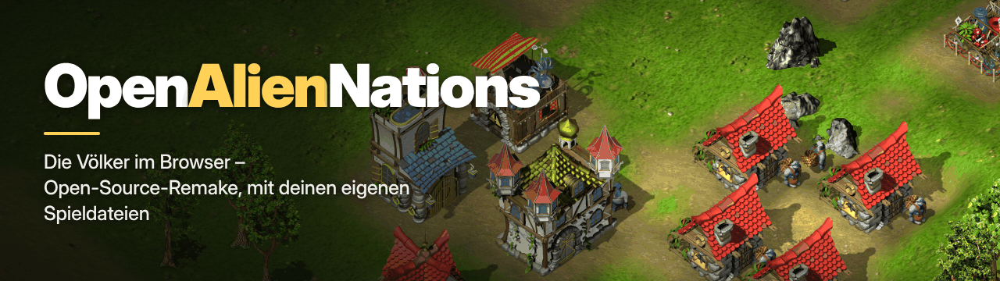

<p align="center">🇬🇧 <a href="README.md">English</a> &nbsp;|&nbsp; 🇩🇪 <b>Deutsch</b></p>

<p align="center"></p>

# OpenAlienNations

OpenAlienNations ist ein Open-Source-Nachbau des Strategiespiels **Die Völker** (englisch:
**Alien Nations**) von 1999, der in deinem Webbrowser läuft. Du spielst damit die Kampagnen,
Tutorials und das Endlosspiel des Originals, die Insel-Kampagnen und Schiffe des **Addons der
Gold-Edition** und im **Mehrspielermodus** mit Freunden im Browser, auf Wunsch mit einer
schärferen **HD-Oberfläche**.

Es ist **nicht** das Spiel selbst und enthält **keine Spieldateien**: Du brauchst deine eigene
Version von Die Völker / Alien Nations (GOG oder die Original-CD / Gold-Edition). „Alien Nations“
und „Die Völker“ sind Marken ihrer jeweiligen Inhaber; dies ist ein unabhängiges Fanprojekt, das
in keiner Verbindung zu ihnen steht und nicht von ihnen unterstützt wird.

**Stand:** sehr nah am Original, einschließlich seiner Eigenheiten. Wenn sich etwas anders
spielt als im Original, [melde es bitte als Issue](../../issues).

**[⬇ Neueste Version herunterladen](../../releases/latest)** (Windows und Linux; Docker siehe [Schnellstart](#schnellstart))

## Was du brauchst

- **Die Völker / Alien Nations installiert**: die GOG-Version oder die Original-CD / Gold-Edition.
- **Windows** oder **Linux** (64 Bit, x86) oder etwas, auf dem **Docker** läuft (Server / NAS).
- Einen **aktuellen Webbrowser** (Chrome, Edge, Firefox, Safari).

## Schnellstart

**Windows**
1. Lade `OpenAlienNations-<Version>-windows-x64.exe` herunter und doppelklicke darauf. Die Datei
   ist nicht signiert: Wenn SmartScreen warnt, klicke auf **Weitere Informationen** → **Trotzdem ausführen**.
2. Wähle beim ersten Start deinen Spielordner (eine gefundene Installation ist schon ausgewählt).
3. Das Spiel öffnet sich im Browser. **Lass das Konsolenfenster offen, solange du spielst**; wenn du es schließt, endet das Spiel.

**Linux (x64):** `tar xzf OpenAlienNations-<Version>-linux-x64.tar.gz`, dann `./OpenAlienNations`.
Das Programm fragt nach dem Spielordner (Dialog oder Terminal); Wine- und Lutris-Installationen gehen auch.

**Docker (Server / NAS):**
```
docker run -d --name openaliennations -p 8080:8080 -v "/pfad/zu/Alien Nations:/game:ro" -e AN_LANG=de ghcr.io/tknlg/openaliennations
```
Dann `http://<Server>:8080/` öffnen. Compose, Musik, Unraid: [docs/server.md](docs/server.md) (englisch).

## Welcher Spielordner?

| Was du hast | Was du bekommst |
|---|---|
| GOG-Version | Grundspiel mit Musik (GOG enthält das Addon nicht) |
| CD-Version | Grundspiel; für Musik eine GOG-Installation oder ausgelesene CD-Titel ([wie](docs/install.md#music), englisch) |
| Gold-Edition | Grundspiel **und** Addon; Musik wie bei der CD-Version |

Wähle den Ordner, der `Data` und `Bin` enthält; mit `--setup` wählst du neu.
Einzelheiten: [docs/install.md](docs/install.md) (englisch).

## Mit Freunden spielen

1. Ein Spieler ist Gastgeber und startet OpenAlienNations (fragt die Windows-Firewall, private Netzwerke erlauben).
2. Die Konsole zeigt die Adressen für Freunde an, z. B. `http://192.168.1.20:8080/`.
3. Die Freunde öffnen sie im Browser; sie **brauchen nur einen Browser**.
4. Der Gastgeber eröffnet im Mehrspieler-Menü einen Raum, die anderen treten bei.

<details><summary>Übers Internet (VPN, Portweiterleitung)</summary>

- **VPN** wie Tailscale, ZeroTier oder Hamachi: Alle treten bei und verwenden die VPN-Adresse des Gastgebers (die Konsole zeigt sie an).
- **Portweiterleitung:** Am Router des Gastgebers den TCP-Port 8080 an dessen Computer weiterleiten; die Freunde verwenden die öffentliche IP-Adresse des Gastgebers.

Mehr in [docs/server.md](docs/server.md#multiplayer-hosting) (englisch).
</details>

## Spielstände

Spielstände werden **in deinem Browser** gespeichert, getrennt für jeden Browser und jede Adresse.
Zum Sichern oder Mitnehmen: **Exportieren** / **Importieren** im Menü **Spiel laden**.

## Einstellungen im Spiel

Einstellungen → Grafik → **HD-Grafik** schaltet die HD-Oberfläche um; Einstellungen → **Erweitert** enthält optionale Komfortfunktionen, die es im Original nicht gibt, alle standardmäßig aus.

## Probleme?

<details><summary>Häufige Lösungen</summary>

- **Port 8080 ist belegt:** Ohne `--port` wird der nächste freie Port genommen; mit `--port` einen anderen wählen, z. B. `--port 9000`.
- **Keine Musik:** siehe [Music](docs/install.md#music) (englisch); mit `--music <Ordner>` starten.
- **Addon-Menüs fehlen:** Der Spielordner muss die Gold-Edition-Installation sein; mit `--setup` neu wählen.
- **Spielstände sind weg:** Dieselbe Adresse mit demselben Port öffnen wie vorher.

Mehr in [docs/faq.md](docs/faq.md) (englisch).
</details>

## Mehr (englisch)

[Installation](docs/install.md) · [Optionen](docs/options.md) · [Server, NAS & Mehrspieler](docs/server.md) ·
[FAQ](docs/faq.md) · [Mitmachen](CONTRIBUTING.md) · [Projektstand](docs/status.md)

## Lizenz

Code und Dokumentation stehen unter der **GNU General Public License v3.0 oder neuer**
([LICENSE](LICENSE)). Das HD-Oberflächenpaket (`hd/`) und die Bannerbilder (`docs/images/`) zeigen
die Grafiken des Originalspiels und fallen **nicht** unter die GPL. Einzelheiten (englisch): [NOTICE](NOTICE).
