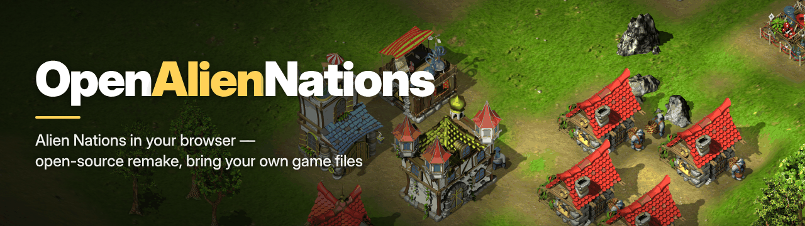

<p align="center">🇬🇧 <b>English</b> &nbsp;|&nbsp; 🇩🇪 <a href="README.de.md">Deutsch</a></p>

<p align="center"></p>

# OpenAlienNations

OpenAlienNations is an open-source remake of the 1999 strategy game **Alien Nations** (German:
**Die Völker**) that runs in your web browser. It plays the campaigns, tutorials and free play of
the original, the island campaigns and ships of the **Gold Edition add-on**, and **multiplayer**
with friends in the browser, optionally with a sharper **HD interface**.

It is **not** the game itself and contains **no game files**: you need your own copy of
Alien Nations (GOG, or the original CD / Gold Edition). "Alien Nations" and "Die Völker" are
trademarks of their respective owners; this is an independent fan project, not affiliated with
or endorsed by them.

**Status:** very close to the original, including its quirks. If something plays differently
from the original game, please [open an issue](../../issues).

**[⬇ Download the latest release](../../releases/latest)** (Windows and Linux; Docker see [Quick start](#quick-start))

## What you need

- **Alien Nations installed**: the GOG version, or the original CD / Gold Edition.
- **Windows** or **Linux** (64-bit x86), or anything that runs **Docker** (server / NAS).
- A **modern web browser** (Chrome, Edge, Firefox, Safari).

## Quick start

**Windows**
1. Download `OpenAlienNations-<version>-windows-x64.exe` and double-click it. It is not signed:
   if SmartScreen warns, click **More info** → **Run anyway**.
2. The first time, choose your game folder (a found install is already selected).
3. The game opens in your browser. **Keep the console window open while you play**; closing it stops the game.

**Linux (x64):** `tar xzf OpenAlienNations-<version>-linux-x64.tar.gz`, then `./OpenAlienNations`.
It asks for the game folder (dialog or terminal); Wine and Lutris installs work too.

**Docker (server / NAS):**
```
docker run -d --name openaliennations -p 8080:8080 -v "/path/to/Alien Nations:/game:ro" ghcr.io/tknlg/openaliennations
```
Then open `http://<server>:8080/`. Compose, music, Unraid: [docs/server.md](docs/server.md).

## Which game folder?

| What you have | What you get |
|---|---|
| GOG version | base game with music (GOG has no add-on) |
| CD version | base game; music needs a GOG install or ripped CD tracks ([how](docs/install.md#music)) |
| Gold Edition | base game **and** add-on; music like the CD version |

Point it at the folder that contains `Data` and `Bin`; start with `--setup` to choose again.
Details: [docs/install.md](docs/install.md).

## Play with friends

1. One player hosts: starts OpenAlienNations (if Windows Firewall asks, allow private networks).
2. The console lists addresses for friends, e.g. `http://192.168.1.20:8080/`.
3. Friends open it in their browser; they **need nothing but a browser**.
4. The host opens a room in the multiplayer menu, the others join.

<details><summary>Over the internet (VPN, port forwarding)</summary>

- **VPN** such as Tailscale, ZeroTier or Hamachi: everyone joins it, then uses the host's VPN address (the console lists it).
- **Port forwarding:** forward TCP port 8080 on the host's router to the host; friends use the host's public IP.

More in [docs/server.md](docs/server.md#multiplayer-hosting).
</details>

## Saves

Saved games are stored **in your browser**, separately for each browser and address. To back them
up or move them, use **Exportieren** / **Importieren** in the **Spiel laden** menu.

## In-game settings

Einstellungen → Grafik → **HD-Grafik** switches the HD interface; Einstellungen → **Erweitert** has optional comforts that are not in the original, all off by default.

## Problems?

<details><summary>Common fixes</summary>

- **Port 8080 already in use:** without `--port` the next free port is taken; with it, pick another, e.g. `--port 9000`.
- **No music:** see [Music](docs/install.md#music); start with `--music <folder>`.
- **Add-on menus missing:** the game folder must be the Gold Edition install; `--setup` to choose again.
- **Saves are gone:** open the same address and port as before.

More in [docs/faq.md](docs/faq.md).
</details>

## More

[Installing](docs/install.md) · [Options](docs/options.md) · [Server, NAS & multiplayer](docs/server.md) ·
[FAQ](docs/faq.md) · [Contributing](CONTRIBUTING.md) · [Project status](docs/status.md)

## License

The code and documentation are licensed under the **GNU General Public License v3.0 or later**
([LICENSE](LICENSE)). The HD interface pack (`hd/`) and the banner images (`docs/images/`) show
the original game's artwork and are **not** covered by the GPL. Details: [NOTICE](NOTICE).
